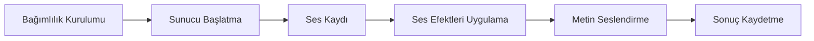

<div align="center">

</div>

Ses Klonlama, Türkçe odaklı bir uygulama, Chatterbox Multilingual modeli kullanarak metni seslendirir ve ses klonlamayı sağlar. Kullanıcılar, ses kaydını başlatma, durdurma ve indirme, metni seslendirme ve ses efektleri uygulama gibi işlevleri sunar. Bu uygulama, profesyonel ses işleme ve metin seslendirme ihtiyaçlarını karşılar.

<p align="center">
  
  
  
  
  
  
  
</p>

<details>
<summary><b>📋 İçindekiler</b></summary>

- [✨ Özellikler](#-özellikler)
- [⚙️ Nasıl Çalışır](#-nasıl-çalışır)
- [📦 Kurulum](#-kurulum)
- [🚀 Kullanım](#-kullanım)
- [🔧 Yapılandırma](#-yapılandırma)
- [🔌 API Referansı](#-api-referansı)
- [📁 Proje Yapısı](#-proje-yapısı)
- [🤝 Katkıda Bulunma](#-katkıda-bulunma)
- [👤 Geliştirici](#-geliştirici)

</details>

## ✨ Özellikler

### 🎧 Ses Kaydı ve Klonlama

- Ses kaydını başlatma ve durdurma
- Kaydedilen sesi indirme
- Referans ses dosyası yükleme veya kaydetme
- Ses klonlaması ve metin seslendirme

### 🎶 Ses Efektleri

- Profesyonel DSP efektlerinin uygulanması
- Ses hızını değiştirme
- Ses tonunu değiştirme
- Ses kalitesini arttırmak

### 📝 Metin Seslendirme

- Türkçe metin normalizasyonu
- Duygu tespiti
- TTS dosyaları oluşturma
- Ses kimliği öğrenme

### 🌐 API EndPoint'leri

- HTTP rotaları sunma
- Ses kaydını başlatma
- Ses kaydını durdurma
- Ses kaydını indirme

### 📊 Grafik Kullanıcı Arayüzü

- Gömülü HTML/JS arayüzü
- Dark-mode destek
- Mikrofon kaydı
- Ses klonlaması ve TTS kontrolü

### 🛠 Teknik Özellikler

- FastAPI sunucu
- Tkinter kontrol paneli
- CUDA 11.8 desteği
- FFmpeg ses işleme


## ⚙️ Nasıl Çalışır



1. **Bağımlılık Kurulumu** — Paketlerin otomatik veya manuel kurulumu
2. **Sunucu Başlatma** — FastAPI sunucu ve Tkinter kontrol paneli başlatılması
3. **Ses Kaydı** — Mikrofon kaydı başlatılması ve ses kaydının durdurulması
4. **Ses Efektleri Uygulama** — DSP efektlerinin uygulanması ve ses kalitesinin artırılması
5. **Metin Seslendirme** — Türkçe metin normalizasyonu ve TTS dosyalarının oluşturulması
6. **Sonuç Kaydetme** — Ses dosyasının kaydetme ve sunucudan indirilmesi

| Bileşen | Görev |
| --- | --- |
| `app.py` | Ana uygulama: bootstrap ve FastAPI sunucu |
| `panel.py` | Tkinter masaüstü kontrol paneli |
| `chatterbox_tts_engine.py` | ChatterboxTTSEngine sınıfı: model yükleme ve ses üretme |
| `audio_effects.py` | DSP efektleri ve preset tanımları |
| `text_normalizer.py` | Türkçe metin normalizasyonu ve duygu tespiti |

## 📦 Kurulum

**Gereksinimler:** Python 3.10+

```bash
# Repoyu klonlayın
git clone https://github.com/Burakcnz/ses_klon.git
cd ses_klon

# Sanal ortam oluşturun
python -m venv .venv

# Sanal ortamı etkinleştirin (macOS/Linux: source .venv/bin/activate)
.venv\Scripts\activate

# Bağımlılıkları yükleyin
pip install fastapi pydantic torch torchaudio numpy pedalboard librosa uvicorn chatterbox
```

## 🚀 Kullanım

```bash
python app.py
```

Uygulama varsayılan olarak <http://localhost:8000> adresinde açılır. Windows'ta `başlat.bat` dosyasına çift tıklayarak da başlatabilirsiniz.

#### Ses Kaydını Başlatma ve Durdurma

1. Tkinter panelini açın
2. Başlat butonuna tıklayın
3. Ses kaydını başlatın
4. Ses kaydını 10-30 saniye boyunca kaydedin
5. Durdur butonuna tıklayın

#### Metni Seslendirme

1. Tkinter panelini açın
2. Metin kutusuna istediğiniz metni girin
3. Seslendir butonuna tıklayın
4. Ses dosyası oluşturun ve indirin

#### Ses Efektleri Uygulama

1. Tkinter panelini açın
2. Ses dosyasını seçin
3. Efekt uygulama butonuna tıklayın
4. Uygulanan efektleri gözlemleyin

## 🔧 Yapılandırma

Ayarlar ortam değişkenleriyle yapılır (`.env` dosyası veya sistem ortamı):

| Değişken | Varsayılan | Açıklama |
| --- | --- | --- |
| `SES_KLON_SERVE` | — | Ses Klon uygulamasının sunucu modu için yapılandırma değişkeni |

## 🔌 API Referansı

Toplam **12** uç nokta.

<details>
<summary><b>app.py</b> (12)</summary>

| Yöntem | Yol | Açıklama |
| --- | --- | --- |
| `GET` | `/` | Ana sayfayı gösterir |
| `GET` | `/status` | Sunucunun durumunu gösterir |
| `GET` | `/history` | Tarihçiyi gösterir |
| `POST` | `/history/{gen_id}/rename` | Tarihçe öğesinin ismini değiştirir |
| `DELETE` | `/history/{gen_id}` | Tarihçe öğesini siler |
| `GET` | `/history/{gen_id}/download` | Tarihçe öğesini indirir |
| `GET` | `/effects-info` | Efekt bilgilerini gösterir |
| `GET` | `/voices` | Kullanılabilir sesleri listeler |
| `POST` | `/upload-voice` | Yeni ses dosyası yükler |
| `POST` | `/set-active-voice` | Aktif sesi ayarlar |
| `DELETE` | `/delete-voice/{name}` | Ses dosyasını siler |
| `POST` | `/generate-tts` | Metni seslendirir |

</details>

## 📁 Proje Yapısı

```text
├── assets/
├── history/
│   └── meta.json
├── logs/
├── output/
├── voices/
│   ├── bcz.wav
│   ├── klon1.wav
│   └── klon2.wav
├── AGENTS.md
├── app.py
├── audio_effects.py
├── başlat.bat
├── chatterbox_tts_engine.py
├── opencode.json
├── panel.py
├── README.md
├── text_normalizer.py
└── …
```

## 🤝 Katkıda Bulunma

Katkılarınızı bekliyoruz! Şu adımları izleyin:

1. Repoyu fork'layın
2. Yeni bir dal oluşturun (`git checkout -b ozellik/yeni-ozellik`)
3. Değişikliklerinizi commit'leyin (`git commit -m 'Yeni özellik ekle'`)
4. Dalınızı push'layın (`git push origin ozellik/yeni-ozellik`)
5. Bir Pull Request açın

## 👤 Geliştirici

<p align="center">
  <a href="https://github.com/Burakcnz"></a>
  <br />
  <b>Burak Can Zengin</b> · <a href="https://github.com/Burakcnz">@Burakcnz</a>
</p>

<p align="center"><a href="https://github.com/Burakcnz/ses_klon">⭐ Projeyi beğendiyseniz yıldız vermeyi unutmayın!</a></p>


